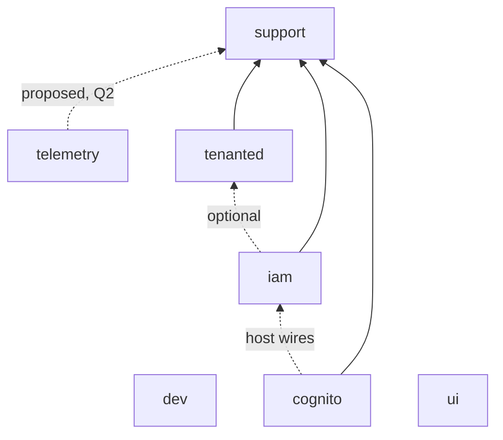

# Architecture

**Status: Draft for review (2026-10-22).** Nothing is checked against this until it is agreed;
then `pt engine check` (D0) enforces the contract below.

Partitia is a family of Rails engines that apps compose. Each engine is a gem in this repo
(`<dir>/partitia-<dir>.gemspec`), developed against a `spec/dummy` app, and installed into an
app by its own generator.

## Layers

| Layer | Engines | Job |
|---|---|---|
| Base | support, dev, telemetry | What every engine and app uses: config, logging, instrumentation, the plugin registry, console tooling, the bridge to OpenTelemetry |
| Identity | tenanted, iam, cognito | Who is asking and in which tenant: tenancy (optional), principals and authorization, sign-in through an IdP |
| Presentation | ui (shelved) | Shared Phlex/RubyUI components, when engines start duplicating view code |

**Dependencies point down or sideways, never up.** Base never depends on identity. support depends
on no sibling. Within a layer an engine may integrate with another only optionally (below).

## The engine contract

An engine meets every rule, or the exception is written here with its reason.

### 1. Naming

- Gem `partitia-<name>`, module `Partitia::<Name>`, require `partitia/<name>`. `Iam`, `Ui`: no
  acronym inflections (they change the host's inflections).
- No top-level constants. Tables `partitia_<name>_*`; events, spans and log tags
  `partitia_<name>.*`; config `partitia_<name>` (`config/partitia_<name>.yml`,
  `PARTITIA_<NAME>_*`); generators `partitia:<name>:<generator>`; rake `partitia:<name>:*`.

### 2. Dependencies

- Every sibling the code needs at runtime is a gemspec dependency.
- An optional sibling is detected with `defined?(Partitia::<Name>)`, never required, and each
  integration is listed in the engine's README ("With partitia-tenanted: …").
- Cross-engine wiring the engine cannot know goes through a hook the host or the other engine
  fills (`Partitia::Tenanted.after_provision`, `Partitia::Cognito.identity_resolver`), never a
  constant reference across engines.

### 3. Registration

- The engine registers itself: `Partitia::Support.plugins << self` in its engine class. That is
  how its migrations reach the app (`Partitia::Support.migrations_paths`, per scope) and its
  views and components reach Tailwind (`Partitia::Support.source_paths`).

### 4. Configuration

- One `Partitia::Support::Config` subclass, `config_name :partitia_<name>`. Values resolve from
  `config/partitia_<name>.yml`, then credentials, then `PARTITIA_<NAME>_*`; nothing reads ENV
  directly.
- Secrets only from credentials or ENV. A development fallback is allowed only when it is
  labelled not-a-secret and production refuses it.
- Endpoints default to the pcm service a developer runs (`stack/telemetry`, `stack/authentik`,
  `stack/glitchtip`), so a generated app works against `pcm up` with no edits.
- Callables the host must provide (resolvers, guards) are module-level slots that **fail loudly
  or deny** when unset, never silently allow.

### 5. Install generator

- `partitia:<name>:install` exists, even when it has little to do.
- **Idempotent:** a second run changes nothing and asks nothing. Every write is guarded.
- **Never overwrites a host file wholesale** (`force: true`); it injects into it, or stops and
  says what to change.
- Migrations reach the app through the registry (`migrations_paths` in `database.yml`), not by
  copying.
- It ends by printing what the host still has to do, if anything.

### 6. Tenancy

- Works in a single-tenant app and a multi-tenant one with no code change in the engine.
  Multi-tenant behavior switches on when partitia-tenanted is present.
- Tenant-plane tables in `db/migrate`; global-plane tables in `db/global_migrate`; the reserved
  platform database holds identity only (ADR 0003).

### 7. Observability

- Models and controllers log and instrument through `Partitia::Support::Logging` and
  `Instrumentable` (the support railtie injects them). Events are
  `partitia_<name>.<class>.<verb>`.
- No payload key is in `Partitia::Support::RedactionConfig.sensitive_fields`.
- Spans and dashboards are named for the code, not the app (ADR 0007): the app is
  `service.name`.

### 8. Views

- Phlex classes that use RubyUI components; no ERB. The engine lists the RubyUI components it
  uses, and its installer adds them to the app.
- Engine controllers inherit the host's `ApplicationController` unless isolation is the point
  (cognito's broker), which is then stated.

### 9. Services

- An engine that needs an external service names the pcm service in its gemspec metadata
  (`spec.metadata["partitia.services"] = "telemetry"`), so `pt services` can start what an app
  needs.

### 10. Tests and CI

- `spec/dummy`, with `ActiveRecord::Migration.maintain_test_schema!` in `spec/rails_helper.rb`.
- `required_ruby_version` in the gemspec; lockfile platforms `arm64-darwin`,
  `x86_64-linux-gnu`, `aarch64-linux-gnu`.
- An entry in both CI matrices.

## Where each engine stands

Gaps against the contract, from the code on 2026-10-22. These become D3's work list.

| Engine | Gaps |
|---|---|
| support | Install generator only finds the sqlite development line in `database.yml` and says nothing when it can't (§5). It is a railtie, not an engine, so §3, §6 and §8 don't apply |
| dev | Console-only railtie: no generator, no config, no registration. Proposed exempt (see Q1). No specs |
| telemetry | No dependency on support, so its span bridge can't check `RedactionConfig` (§2, §7). No config class: the generator writes an initializer reading `OTEL_*` (§4). Generator re-run relies on Thor's conflict prompt (§5). No `partitia.services` (§9) |
| tenanted | Not isolated (by design: `tenants` routes drawn into the host). Install writes `database.yml` with `force: true` (§5); writes controllers and an initializer unguarded (§5). Views are ERB (§8). No config class: module accessors only (§4). `views` generator offers `accounts`, which the gem doesn't have, and rejects `tenant_not_found`, which its own template tells you to run |
| iam | Install writes only a commented initializer; its credentials key says `iam:` instead of `partitia_iam:` (§4). Layout is ERB (§8). `lockbox` declared but unused (§2) |
| cognito | Not registered (§3). Install writes the initializer unguarded (§5). The dummy's Authentik harness is its own docker compose (Authentik 2024.10.5) instead of pcm's `stack/authentik` (§4, §9). No `partitia.services` |
| ui | Shelved. Not registered, so its components never reach Tailwind (§3). Defines top-level `Views`, `Components`, `RubyUI` and points the host's autoloader at them (§1; see Q4). No install generator |

## Wiring an app today

What a host does now, from the dummies and generators. D3 and D5 move these steps into
generators and templates until `pt new` does all of it.

**Single-tenant, iam + cognito:** add the gems; `migrations_paths` for `primary` in
`database.yml`; `db:migrate`; `partitia:iam:install` (production: `PARTITIA_IAM_HMAC_KEY`);
`partitia:cognito:install` (mounts `/auth`); issuer, client id and secret; register
`<host>/auth/callback` in the IdP; `include Partitia::Iam::Authenticatable` and
`before_action :require_authentication` where needed.

**Multi-tenant, + tenanted:** `partitia:tenanted:install` first (database planes, resolution,
tenant controllers); then iam and cognito as above; then an initializer like
`tenanted/spec/dummy/config/initializers/identity.rb` (the Rack tenant resolver so the
`/auth/callback` runs in the tenant's database, `identity_resolver`, `policy_resolver`,
`platform_console_guard`); `provision_platform!`, then a `Tenant` per tenant.

## Questions for review

- **Q1 — dev.** It is console tooling, loaded only in `rails console`. Exempt it from §3–§6 and
  §9 (it registers nothing, configures nothing, installs by being in the Gemfile)?
- **Q2 — telemetry → support.** Make support a dependency of telemetry so the span bridge drops
  sensitive keys (§7), and give telemetry a config class for its endpoint and prefixes (§4)?
- **Q3 — migrations.** The registry (`migrations_paths` in `database.yml`, nothing copied) or
  Rails' usual `railties:install:migrations` copy? The code supports both; the contract should
  pick one. Proposed: the registry, so an engine's schema changes reach every app without a
  copy step.
- **Q4 — ui's top-level modules.** Phlex and RubyUI expect `Views`, `Components` and `RubyUI` at
  the top level of the app. Allow that as the one exception to §1, or wrap them?
- **Q5 — tenanted's routes.** It draws `resources :tenants` into the host instead of being
  mounted. Keep (tenancy is the app's routing, not a feature at a path), or mount it like the
  others?
- **Q6 — registration for every engine.** cognito has no tables or views today. Register it
  anyway, so every engine is found the same way?
- **Q7 — authorization.** ADR 0001 planned one Pundit entry point with a fail-closed
  `verify_authorized`; it was never built, and the tenanted dummy uses Pundit directly. Part of
  iam's contract now, or a later destination?
