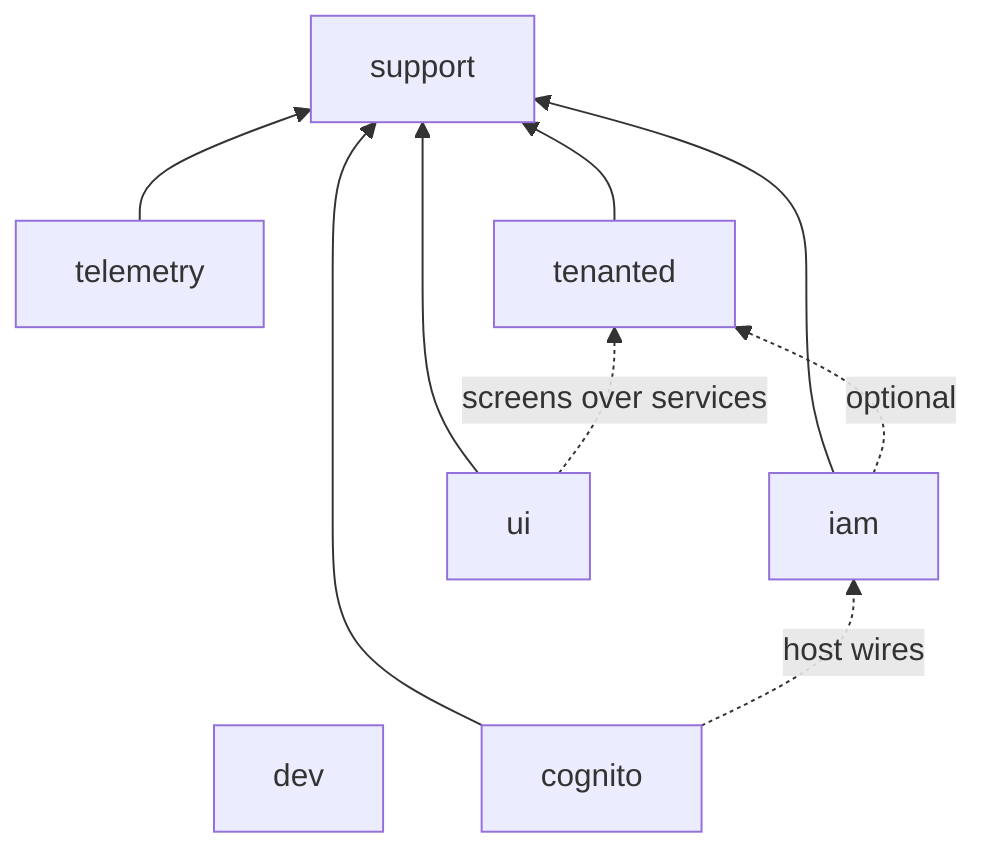

# Architecture

**Status: Agreed (2026-10-22).** `cnfs engine check` (D0) is to enforce the contract below. The
decisions behind it, with the evidence from the earlier apps, are at the end.

Partitia is a family of Rails engines that apps compose. Each engine is a gem in this repo
(`<dir>/partitia-<dir>.gemspec`), developed against a `spec/dummy` app, and installed into an
app by its own generator.

## Layers

| Layer | Engines | Job |
|---|---|---|
| Base | support, dev, telemetry | What every engine and app uses: config, logging, instrumentation, the plugin registry, console tooling, the bridge to OpenTelemetry |
| Identity | tenanted, iam, cognito | Who is asking and in which tenant: tenancy (optional), principals and authorization, sign-in through an IdP |
| Presentation | ui | partitia's only UI (ADR 0008): Phlex + RubyUI operator screens over the core gems' services, their thin controllers, the default shell. Every other engine is headless |

**Dependencies point down or sideways, never up.** Base never depends on identity. support depends
on no sibling. Within a layer an engine may integrate with another only optionally (below).

## The engine contract

An engine meets every rule, or the exception is written here with its reason.

### 1. Naming

- Gem `partitia-<name>`, module `Partitia::<Name>`, require `partitia/<name>`. `Iam`, `Ui`: no
  acronym inflections (they change the host's inflections).
- No top-level constants, with one exception: the Phlex/RubyUI host namespaces `Views`,
  `Components` and `RubyUI`, which those libraries expect at the top of the app (Q4). Tables
  `partitia_<name>_*`; events, spans and log tags
  `partitia_<name>.*`; config `partitia_<name>` (`config/partitia_<name>.yml`,
  `PARTITIA_<NAME>_*`); generators `partitia:<name>:<generator>`; rake `partitia:<name>:*`.

### 2. Dependencies

- Every sibling the code needs at runtime is a gemspec dependency.
- An optional sibling is detected with `defined?(Partitia::<Name>)`, never required, and each
  integration is listed in the engine's README ("With partitia-tenanted: …").
- Cross-engine wiring the engine cannot know goes through a hook the host or the other engine
  fills (`Partitia::Tenanted.after_provision`, `Partitia::Cognito.identity_resolver`), never a
  constant reference across engines.

### 3. Registration

- Every engine (a `Rails::Engine`; the registry takes nothing else) registers itself, whether
  or not it has tables or views today (Q6). The railtie gems (support, dev, telemetry) have
  nothing to register:
  `Partitia::Support.plugins << self` in its engine class. That is how its migrations reach the
  app (`Partitia::Support.migrations_paths`, per scope) and its views and components reach
  Tailwind (`Partitia::Support.source_paths`).
- **Exempt: dev** (Q1). It is console tooling, loaded only by `rails console`: no registration,
  config, install generator, tenancy or services (§3–§6, §9). Engines still add their console
  helpers to it (`Partitia::Dev.console`, behind `defined?(Partitia::Dev)`); the earlier apps
  were driven mostly from the console, so helpers like switching tenant are worth the most.

### 4. Configuration

- Settings live in one `Partitia::Support::Config` subclass, `config_name :partitia_<name>` (an
  engine with no settings has none; callables are not settings, see below). Values resolve from
  `config/partitia_<name>.yml`, then credentials, then `PARTITIA_<NAME>_*`; nothing reads ENV
  directly. One exception: telemetry steps aside for the standard `OTEL_*` variables when they
  are set, as OpenTelemetry's own convention says.
- Secrets only from credentials or ENV. A development fallback is allowed only when it is
  labelled not-a-secret and production refuses it.
- Endpoints default to the pcm service a developer runs (`stack/telemetry`, `stack/authentik`,
  `stack/glitchtip`), so a generated app works against `pcm up` with no edits. No endpoint, DSN
  or client secret is written into the app as a literal.
- Callables the host must provide (resolvers, guards) are module-level slots that **fail loudly
  or deny** when unset, never silently allow.

### 5. Install generator

- `partitia:<name>:install` exists, even when it has little to do.
- **Idempotent:** a second run changes nothing and asks nothing. Every write is guarded.
- **Never overwrites a host file wholesale** (`force: true` on `template`, `create_file`,
  `copy_file` or `directory`); it injects into it, or stops and says what to change. `force:` on
  `insert_into_file` is fine: it only lets the same line into a file twice. One exception: a file
  that is still exactly what `rails new` wrote may be replaced (tenanted's `database.yml`); the
  line says so with `# §5: stock file only`, and anything else stops with a non-zero exit and
  the change to make.
- Migrations reach the app through the registry (`migrations_paths` in `database.yml`), not by
  copying (Q3). The generator wires **every environment** (development, test, production), and
  every plane the engine has (a global plane is registered by the engine, never by a line in
  the app).
- What a request carries that is secret (OAuth `code` and `state`, tokens) is added to
  `filter_parameter_logging`.
- It ends by printing what the host still has to do, if anything, and the entry points it
  added (paths such as `/auth/login`).
- Migrations are edited in place only before the first release; after it, a change is a new
  migration.

### 6. Tenancy

- Works in a single-tenant app and a multi-tenant one with no code change in the engine.
  Multi-tenant behavior switches on when partitia-tenanted is present.
- Tenant-plane tables in `db/migrate`; global-plane tables in `db/global_migrate`; the reserved
  platform database holds identity only (ADR 0003).

### 7. Observability

- Models and controllers log and instrument through `Partitia::Support::Logging` and
  `Instrumentable` (the support railtie injects them). Events are
  `partitia_<name>.<class>.<verb>`.
- No payload key is in `Partitia::Support::RedactionConfig.sensitive_fields`, and the bridge to
  spans drops any that is (telemetry depends on support for this, Q2).
- telemetry owns the app's observability settings in one config class: service name, OTLP
  endpoint and the error tracker's DSN (GlitchTip, through `sentry-rails`), each defaulting to the
  pcm service. Installing it without its generator must not be a silent no-op.
- Spans and dashboards are named for the code, not the app (ADR 0007): the app is
  `service.name`.

### 8. Views (ADR 0008)

- **Core engines are headless:** no screens, no layouts, no front-end gem dependencies (turbo,
  stimulus, importmap, tailwind). Their public surface is their services, query objects,
  middleware and seams.
- **Two exceptions, both plumbing:**
  - protocol flows (cognito's `/auth/login`, `/auth/callback`, `/auth/logout`);
  - system pages ("workspace unknown", "sign-in unavailable", the apex 404). These are minimal
    plain HTML from i18n strings with no layout, overridable by the host at the same view path.
- **Screens live in `partitia-ui`:** Phlex classes using RubyUI components, with thin
  controllers calling the core's services, mounted only when the app installs it. Keep logic
  out of components, so a toolkit change touches only the view layer.
- **Navigation:** engines register navigation items in support's registry (sections per
  context; label, path, icon, order, `visible_if`) and ship no layouts. partitia-ui's shell
  renders the registry, and the app's layout uses or replaces the shell.
- **Looks:** components use semantic design tokens (CSS variables, shadcn names) whose values
  the app defines.
- **Engine controllers** inherit the host's `ApplicationController` unless isolation is the
  point (cognito's broker), which is then stated.
- **Until the headless cleanup and D9:** tenanted's console and iam's layout are the known
  exceptions (see below).

### 9. Services

- An engine that needs an external service names the pcm service in its gemspec metadata
  (`spec.metadata["partitia.services"] = "telemetry"`), so `cnfs services` can start what an app
  needs.

### 10. Tests and CI

- `spec/dummy`, with `ActiveRecord::Migration.maintain_test_schema!` in `spec/rails_helper.rb`.
- `required_ruby_version` in the gemspec; lockfile platforms `arm64-darwin`,
  `x86_64-linux-gnu`, `aarch64-linux-gnu`.
- An entry in both CI matrices.

## Where each engine stands

Gaps against the contract, from the code on 2026-10-22. These become D3's work list.

| Engine | Gaps |
|---|---|
| support | None (D3 done). A railtie, not an engine, so §3, §6 and §8 don't apply |
| dev | Exempt from §3–§6 and §9 (Q1). Has specs now. No public `Partitia::Dev.reset!` |
| telemetry | None (D4 done): installed into fresh apps; `cnfs services` provisions GlitchTip and stores the DSN; traces and errors proven end to end (`cnfs smoke`) |
| tenanted | Not yet headless (§8, ADR 0008): its tenant console moves to partitia-ui, its system page becomes plain HTML, and tailwindcss-rails goes. `db:migrate:global` stays in the `db:` namespace on purpose, beside activerecord-tenanted's `db:migrate:tenant`. Migration status also lists activerecord-tenanted's `development-tenant` template database |
| iam | Not yet headless (§8, ADR 0008): its layout and front-end dependencies go. README is otherwise the Rails stub (its Integrations section, §2, is written) |
| cognito | Production has no issuer default and fails at the first discovery call rather than at boot (§4). |
| ui | partitia-ui (ADR 0008): no install generator yet (§5). D9 adds `partitia:ui:install` (Phlex/RubyUI setup, tokens, `@source`), the shell and the tenant console |

## Wiring an app today

`cnfs new single <name>` or `cnfs new multi <name>` does all of this (D5): the `partitia` template
adds the recipe's engines by gem name and runs the steps below; then `cnfs services` provisions
Authentik and GlitchTip, `cnfs server` serves it and `cnfs smoke` checks it. What follows is what the
template does, for reading or for wiring an existing app by hand. Proven on fresh apps
(2026-10-22): each generator run twice, the second changing nothing; both databases migrated.

**Single-tenant** (support, telemetry, iam, cognito): add the gems, then
`partitia:support:install` (the registry line in every environment's primary database),
`partitia:telemetry:install`, `partitia:iam:install`, `partitia:cognito:install` (mounts
`/auth`, writes `config/partitia_cognito.yml`, filters `code`/`state`/`nonce`); `db:prepare`. Each
prints what is left: production secrets, `include Partitia::Iam::Authenticatable` where
sign-in is required; `cnfs services` registers the Authentik client (public, PKCE).

**Multi-tenant** (+ tenanted): `partitia:tenanted:install` **first**, while `database.yml` is
still stock (it writes the global and tenant planes; support's installer then finds them
wired), then the others as above; `db:prepare`; `Partitia::Tenanted.provision_platform!`, then a
`Tenant` per tenant (iam seeds each tenant's account and root on creation). `acme.localhost`
runs in acme's database; an unknown subdomain redirects to `/tenant-unknown`; `/tenants`
answers 403 until `platform_console_guard` is set. Signing in on a tenant's subdomain needs no
wiring: tenanted selects the tenant's database at the Rack layer, so cognito's callback runs
there (D6). Where it selects none there is no sign-in: on an unknown subdomain `/auth/login`
redirects to `/tenant-unknown`, on the apex it is a 404 (tenanted's cognito `before_sign_in`
hook); the platform's sign-in is a host entry point (the tenanted dummy's `/platform/login`).
With telemetry, each request's server span carries `tenant.subdomain` and `tenant.handle`. The first sign-in in any database is root's, with its bootstrap link token
(`bin/rails partitia:iam:bootstrap [TENANT=<subdomain>]`); the template's `/me` shows who is
signed in.

## Decisions (2026-10-22)

The review answered these, checked against the four apps built on the earlier gems (`single`,
`multi`, `factory`, `fudge`).

- **Q1 — dev is exempt** from registration, config, install, tenancy and services. The apps were
  driven mostly from the console (single's log: a dozen web-console sessions; multi's only
  activity: console loads of `Tenant`), so engines keep adding console helpers to it.
- **Q2 — telemetry depends on support** and owns the app's observability settings: service
  name, OTLP endpoint, error-tracker DSN. In the apps the OpenTelemetry endpoint came from raw
  `OTEL_*` variables, the GlitchTip DSN was a literal in an initializer, and multi had the gems
  with no initializer, so it silently exported nothing.
- **Q3 — migrations through the registry.** Every app pointed `database.yml` at the engines'
  migration folders and none copied one; engine migrations ran straight from the gems. The gaps
  were that only development was wired, and multi registered the global plane by hand, pointing
  at a folder it did not have.
- **Q4 — `Views`, `Components`, `RubyUI` may be top-level.** fudge, the UI experiment, shows the
  setup that needs them.
- **Q5 — tenanted keeps drawing its routes into the app.** No app exercised it; the multi demo
  (D6) is the test.
- **Q6 — every engine registers**, cognito included.
- **Q7 — authorization (Pundit) is later**, when the demo needs it. No app used it.

Also from the apps, now rules above: the OAuth `code` and `state` were in single's log (§5,
filtering); single's log shows guesses at the login path before `/auth/login` (§5, print entry
points); single pinned the URN partition to the old `cnfs` placeholder (ADR 0007).
