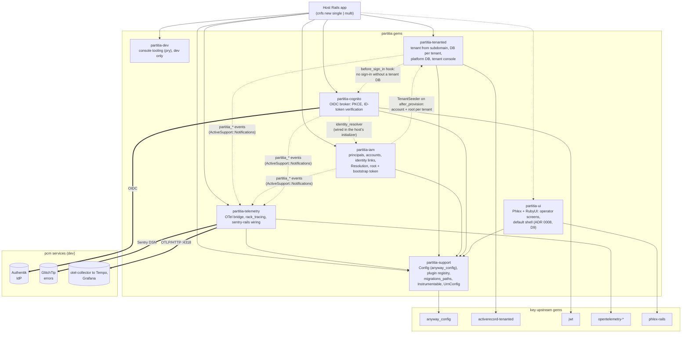
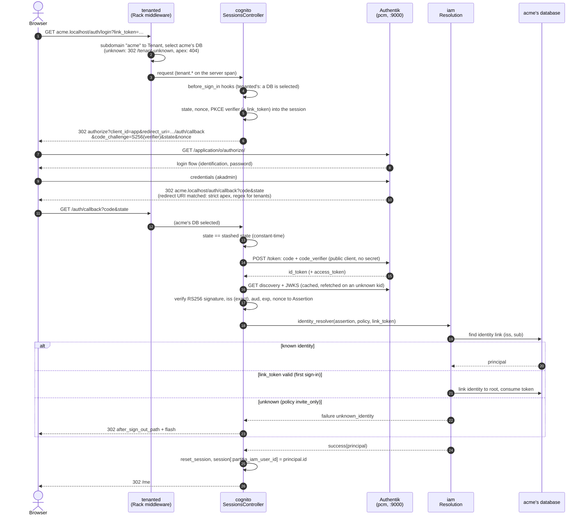
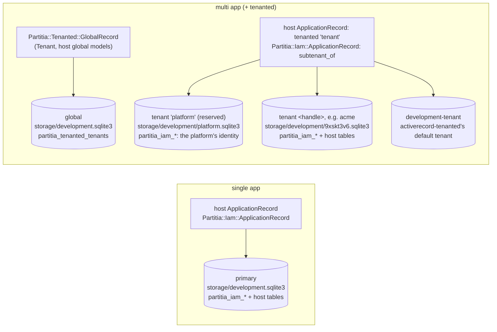
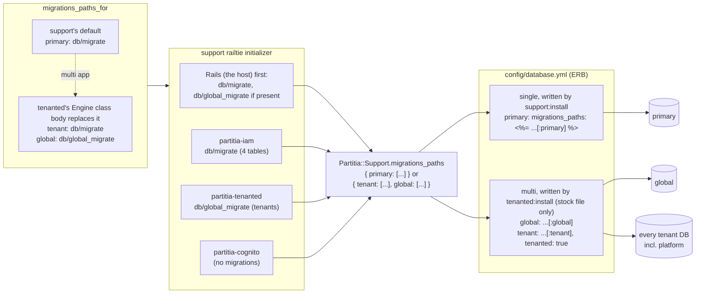
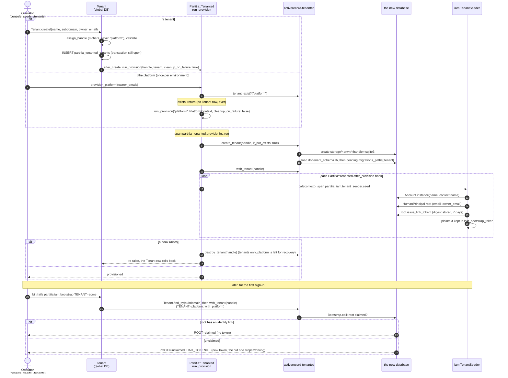
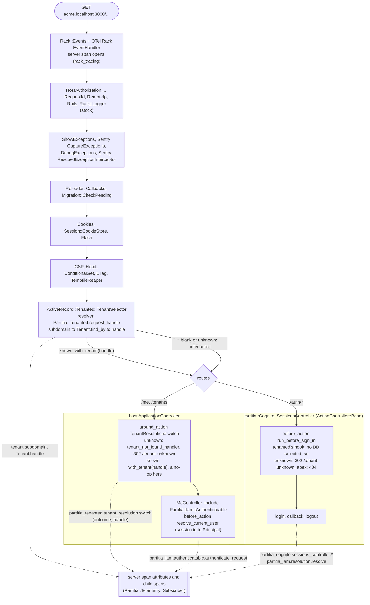
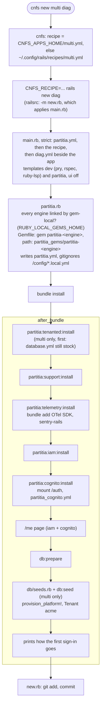
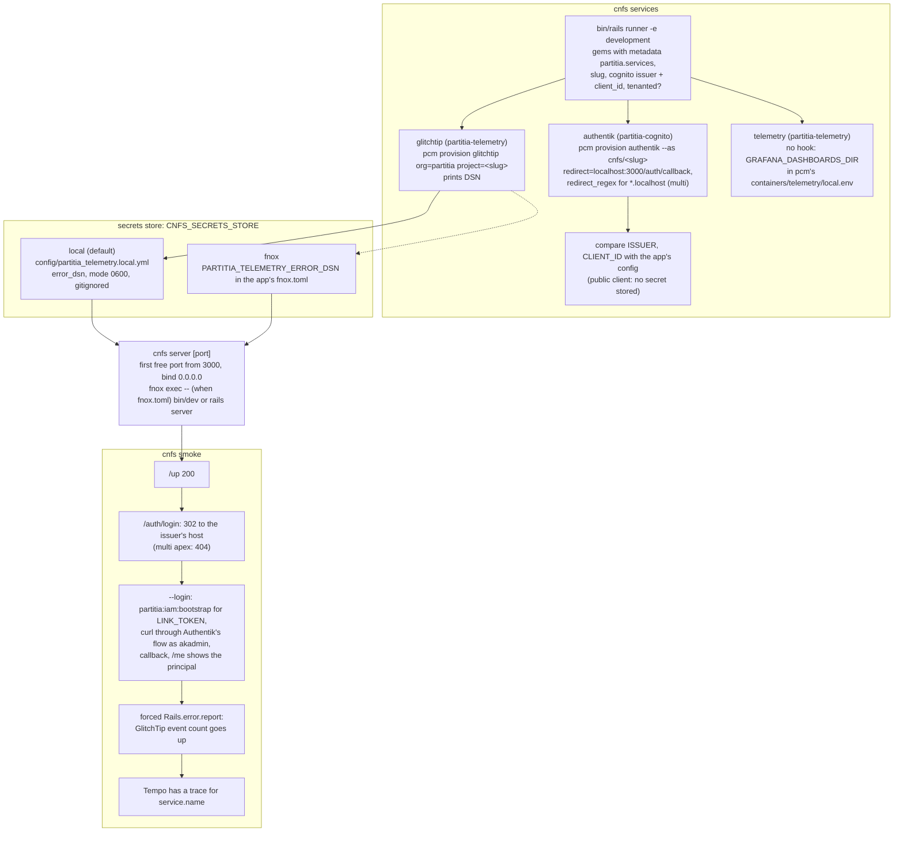
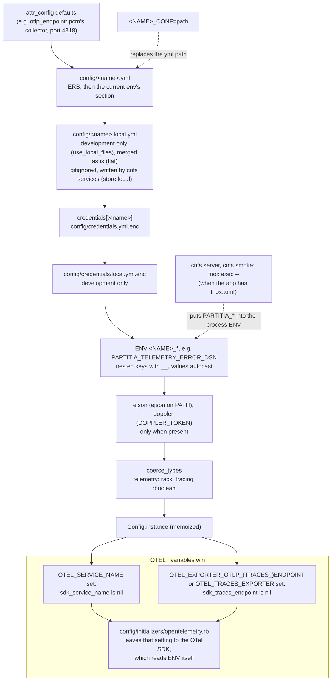

# Diagrams

High-level pictures of the partitia gems, drawn from the code (2026-10-22). `ARCHITECTURE.md` holds the
contract they illustrate.

## 1. The gems and how they relate

The dependencies here are declared in the gemspecs. The integrations between engines are seams:
an engine checks `defined?(...)`, or the host wires it in an initializer. No engine requires a
sibling it doesn't declare, so an app picks any subset its recipe names (`single`: everything
except tenanted and ui; `multi`: adds tenanted).

**Legend:**
- Solid arrows are gemspec dependencies.
- Dotted arrows are optional seams.
- Thick arrows are network calls.

Each engine's gemspec declares the pcm services it needs, in `partitia.services`:
- cognito: `authentik`
- telemetry: `telemetry glitchtip`

`cnfs services` provisions them.

## 2. Sign-in (OIDC authorization code + PKCE through Authentik)

This is a multi-tenant app on `acme.localhost`. In a single-tenant app, tenanted's two steps aren't there and everything runs in the one database.
- **First sign-in:** carries `?link_token=` from `bin/rails partitia:iam:bootstrap`. That claims the root principal.
- **Later sign-ins:** need no token.

**Failure paths not drawn:**
- Authentik unreachable: login and callback answer 503.
- State mismatch or verification failure: redirect with a flash.

Every step emits a `partitia_cognito.*` event, so the whole flow is one trace under the request's server span.

## 3. Databases and where each engine's tables go

A single app has the one `primary` database. A multi app (with tenanted) has no `primary`: a
`global` database for the tenant registry, and a `tenant` database config with `tenanted: true`
that activerecord-tenanted turns into one SQLite file per handle. The reserved `platform`
handle is one of those files.

A model's database comes from its base class:
- `Partitia::Tenanted::GlobalRecord` connects to `global`.
- The host's `ApplicationRecord` calls `tenanted "tenant"`.
- tenanted's `to_prepare` makes every registered engine's `ApplicationRecord` (iam's) a
  `subtenant_of` it.

In a single app nothing reassigns iam's models, so they land in `primary`.

**Not drawn:**
- Production's Solid databases (`cache`, `queue`, `cable`). tenanted's installer keeps them with
  their own `db/*_migrate` folders, and support's installer wires only `primary`.
- The platform database has the full tenant schema, host tables included. Only
  `with_platform`'s scope guard keeps code to the `partitia_iam_` tables there.
- cognito, telemetry and support have no tables.

### How migrations reach each database

Nothing is copied into the app. Each engine adds itself to `Partitia::Support.plugins`. At boot,
support's railtie walks the host (`Rails` first) and then every plugin. For each scope in
`migrations_paths_for` it collects the absolute folder that exists. `database.yml` reads the result
through ERB when Rails loads it.

Who writes what:
- support's installer injects the `[:primary]` line into each environment's primary database.
  It leaves an environment that already reads the registry for any scope alone.
- tenanted's installer replaces a stock `database.yml` and stops on a customized one. That is
  why it runs first.
- iam's installer only checks that the file reads the registry.

The scopes are swapped at load time: tenanted's `Engine` class body runs at `Bundler.require`,
before support's initializer walks the plugins.

## 4. Provisioning a tenant

A tenant is created from the console, from seeds (`cnfs new multi` seeds `acme`), from `/tenants`, or
by `Partitia::Tenanted::Tenant.create!`. All of these go through the `after_create` callback below.
The platform database goes through the same `run_provision`, with a context that has the same
shape (`#name`, `#owner_email`), so iam seeds both with one code path.

The plaintext link token from provisioning is only kept in memory (`last_bootstrap_token`), and
the database stores only its digest. So the first sign-in takes its token from
`partitia:iam:bootstrap`, which issues a new one.

**Not drawn:**
- In a single app nothing provisions. `partitia:iam:bootstrap` with no `TENANT` seeds the app's
  database through the same `TenantSeeder` on its first run.
- The single `last_bootstrap_token` slot races under concurrent provisioning. The code says so.

## 5. A request through a multi app

This is the middleware stack of a fresh `cnfs new multi` app, from `bin/rails middleware` (Rails 8.1,
development). The stock Rails middlewares are grouped.
- The OTel server span opens at the very top.
- tenanted's database selection is the **last** middleware, after cookies, session and flash.
  activerecord-tenanted adds it with `config.middleware.use`.
- The mounted cognito engine's controller inherits `ActionController::Base`, not the host's
  `ApplicationController`, so it never runs `TenantResolution`. That is why the database has to
  be selected at the Rack layer.

**Not drawn:**
- ActionPack renames the server span to the route (`GET /me`), and ActionView adds render spans.
  ActiveRecord is not traced.
- With `rack_tracing` off there is no server span, `set_span_context` is a no-op, and the
  `partitia_*` spans are roots of their own traces.
- A Tenant row whose database file is missing makes TenantSelector raise
  `TenantDoesNotExistError`.
- `/tenants` also runs `platform_console_guard`, which answers 403 until it is set.
- `/tenant-unknown` skips `switch_tenant`.
- In a single app there is no TenantSelector and no `TenantResolution`. The rest is the same.

## 6. The developer toolchain

`cnfs` is a bash CLI in the cnfs anfs source (`packages/rails/home/.local/bin/cnfs`).
It drives `rails new` with the templates in `~/.config/rails`, and pcm for the services.

### `cnfs new [single|multi] <name>`

dev has no installer (Q1). In a single app the tenanted and seed steps are skipped. Every
installer is idempotent, so `cnfs template apply partitia` in the app runs the same steps again.

### `cnfs services`, `cnfs server`, `cnfs smoke`

Options:
- `cnfs services --down` deprovisions, and removes `error_dsn` from the store.
- `cnfs smoke --login --host acme.localhost` signs in on a tenant. Without `--host`, a multi app's
  apex is checked for its 404.

`cnfs smoke` boots the app under `fnox exec` the same way `cnfs server` does. It reads GlitchTip and
Tempo through `pcm exec`, because Tempo publishes no port.

## 7. How a setting resolves

Every `Partitia::Support::Config` subclass resolves the same way:
- `partitia_iam`, `partitia_cognito`, `partitia_telemetry`, `partitia_urn` and
  `partitia_redaction`;
- the order is anyway_config 2.8's loader registry (`Anyway.loaders` with its Rails overrides);
- each source is deep-merged over the one before, so the lowest box wins;
- `.instance` memoizes the result per class, and `reset_instance!` drops it.

**Notes:**
- The `.local.yml` file isn't split by environment. A key there is top-level (`error_dsn: ...`),
  and it's read only in development.
- `coerce_types` matters for ENV: without it `PARTITIA_TELEMETRY_RACK_TRACING=0` autocasts to the
  integer `0`, which is truthy.
- Secrets (`hmac_key`, `client_secret`, `error_dsn`) belong in credentials, ENV, the local file or
  fnox, never in the committed yml.
