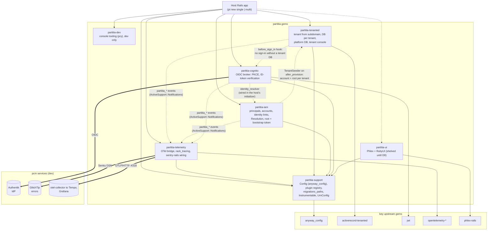
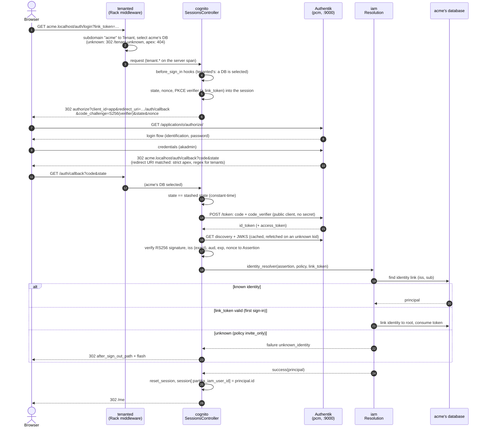

# Diagrams

High-level pictures of the partitia gems, drawn from the code (2026-10-22). `ARCHITECTURE.md` holds the
contract they illustrate.

## 1. The gems and how they relate

The dependencies here are declared in the gemspecs. The integrations between engines are seams:
an engine checks `defined?(...)`, or the host wires it in an initializer. No engine requires a
sibling it doesn't declare, so an app picks any subset its recipe names (`single`: everything
except tenanted and ui; `multi`: adds tenanted).

**Legend:**
- Solid arrows are gemspec dependencies.
- Dotted arrows are optional seams.
- Thick arrows are network calls.

Each engine's gemspec declares the pcm services it needs, in `partitia.services`:
- cognito: `authentik`
- telemetry: `telemetry glitchtip`

`pt services` provisions them.

## 2. Sign-in (OIDC authorization code + PKCE through Authentik)

This is a multi-tenant app on `acme.localhost`. In a single-tenant app, tenanted's two steps aren't there and everything runs in the one database.
- **First sign-in:** carries `?link_token=` from `bin/rails partitia:iam:bootstrap`. That claims the root principal.
- **Later sign-ins:** need no token.

**Failure paths not drawn:**
- Authentik unreachable: login and callback answer 503.
- State mismatch or verification failure: redirect with a flash.

Every step emits a `partitia_cognito.*` event, so the whole flow is one trace under the request's server span.
